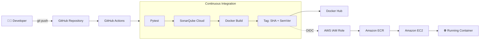
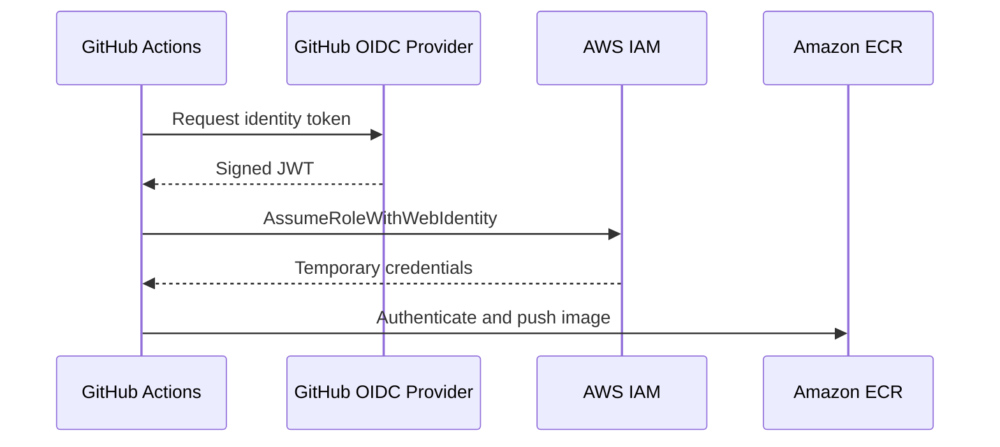
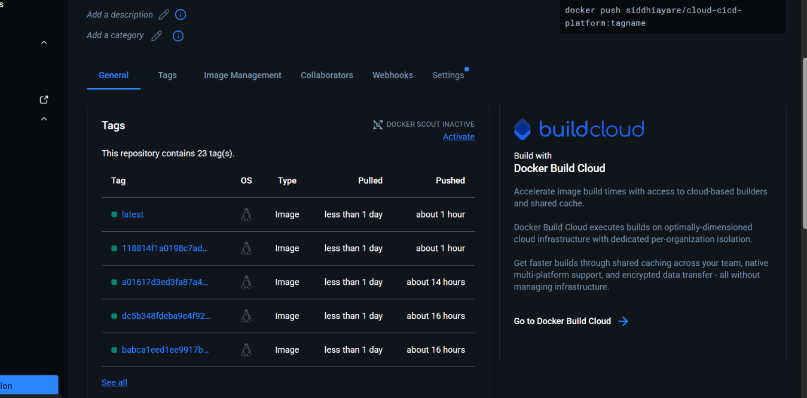
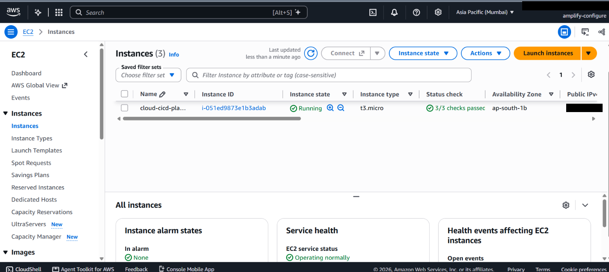
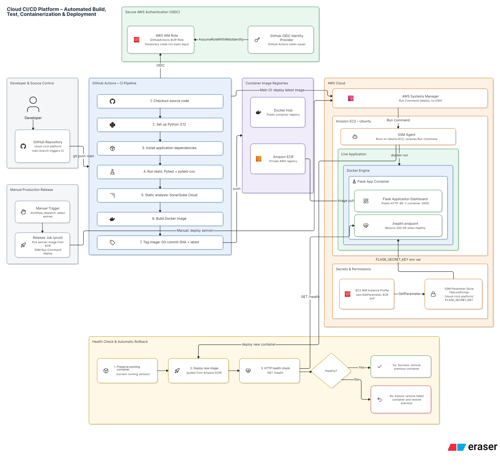

<div align="center">


# ☁️ Cloud CI/CD Platform

**Push code → test → analyse → containerize → publish → deploy. Fully automated.**

An end-to-end DevOps pipeline built with **GitHub Actions, Docker, SonarQube Cloud and AWS** (ECR, EC2, IAM, OIDC).

[](https://github.com/Siddhiayare03/cloud-cicd-platform/actions/workflows/ci.yml)
[](https://sonarcloud.io/summary/new_code?id=Siddhiyare03_cloud-cicd-platform)


[Overview](#-overview) · [Architecture](#-architecture) · [Quick Start](#-quick-start) · [Pipeline](#-pipeline-stages) · [AWS](#-aws-integration) · [Roadmap](#-roadmap)

</div>

---

## 📌 Overview

Manually building apps, running tests, creating Docker images and pushing them to registries is slow and error-prone. This project removes that friction with an automated **CI/CD pipeline** that runs on every push to `main`.

**What happens on each push:**

1. 📥 Checks out the source code
2. 🐍 Sets up Python 3.12 and installs dependencies
3. 🧪 Runs automated tests with **Pytest**
4. 🔍 Runs static analysis with **SonarQube Cloud**
5. 🐳 Builds a **Docker** image
6. 🏷️ Tags it with the **Git SHA** and a **semantic version**
7. 📦 Publishes it to **Docker Hub** (and **Amazon ECR** via the AWS extension)
8. 🚀 Supports **EC2** container deployment and release/changelog management

> [!NOTE]
> Features are marked as complete in the [Project Status](#-project-status) table only after they have been implemented and verified in this repository.

---

## ✨ Key Features

| | Feature | Details |
|---|---|---|
| ⚙️ | **Automated CI/CD** | Event-driven GitHub Actions workflow |
| 🧪 | **Automated testing** | Pytest gate before any image is built |
| 🔍 | **Code quality** | SonarQube Cloud static analysis |
| 🐳 | **Containerization** | Portable, reproducible Docker images |
| 🏷️ | **Smart tagging** | `latest`, `<git-sha>`, and `vMAJOR.MINOR.PATCH` |
| 🔐 | **Keyless AWS auth** | GitHub OIDC → IAM role → temporary credentials |
| ☁️ | **Cloud registry & compute** | Amazon ECR + Amazon EC2 |
| 📝 | **Release management** | Versioned releases and changelogs |

---

## 🏗️ Architecture



<details>
<summary><b>📖 Component responsibilities</b></summary>

| Component | Responsibility |
|---|---|
| GitHub Repository | Source code and version history |
| GitHub Actions | Orchestrates the pipeline |
| Pytest | Validates application behaviour |
| SonarQube Cloud | Static code analysis |
| Docker | Packages the app into an image |
| Docker Hub | Public/private image registry |
| GitHub OIDC | Federated identity between GitHub and AWS |
| AWS IAM | Least-privilege access control |
| Amazon ECR | Private image registry in AWS |
| Amazon EC2 | Compute host for the container |

Docker Hub and Amazon ECR are **independent** publishing paths.

</details>

---

## 🧰 Tech Stack

| Layer | Tools |
|---|---|
| **Language** | Python 3.12 |
| **Source control** | Git, GitHub |
| **CI/CD** | GitHub Actions (YAML, Bash) |
| **Containers** | Docker |
| **Testing** | Pytest |
| **Code quality** | SonarQube Cloud |
| **Registries** | Docker Hub, Amazon ECR |
| **Cloud** | AWS (EC2, ECR, IAM) |
| **Security** | GitHub OIDC, GitHub Secrets |

---

## 📁 Project Structure

```text
cloud-cicd-platform/
├── .github/
│   └── workflows/
│       └── ci.yml                 # CI/CD pipeline definition
├── app/
│   └── app.py                     # Application entry point
├── tests/
│   └── test_app.py                # Pytest test suite
├── docs/
│   └── images/                    # Banner, diagrams, screenshots
├── Dockerfile                     # Container build recipe
├── requirements.txt               # Python dependencies
├── sonar-project.properties       # SonarQube Cloud config
├── .dockerignore
├── .gitignore
└── README.md
```

---

## ⚡ Quick Start

### Prerequisites

- Git
- Python 3.12
- Docker Desktop
- GitHub and Docker Hub accounts
- AWS account *(only for the AWS integration)*

### 1. Clone

```bash
git clone https://github.com/Siddhiayare03/cloud-cicd-platform.git
cd cloud-cicd-platform
```

### 2. Run locally

<details open>
<summary><b>🐍 Python (virtual environment)</b></summary>

```powershell
# Windows PowerShell
python -m venv venv
.\venv\Scripts\Activate.ps1
pip install -r requirements.txt
python app/app.py
```

```bash
# macOS / Linux
python3 -m venv venv
source venv/bin/activate
pip install -r requirements.txt
python app/app.py
```

</details>

<details>
<summary><b>🐳 Docker</b></summary>

```bash
docker build -t cloud-cicd-platform .
docker run -d -p 5000:5000 --name cicd-app cloud-cicd-platform
```

> Adjust the port mapping if your app listens on a different port.

Useful commands:

```bash
docker images            # list images
docker ps                # running containers
docker logs cicd-app     # view logs
docker stop cicd-app     # stop the container
```

</details>

### 3. Run the tests

```bash
pytest -v
pytest -v --tb=short     # compact tracebacks
```

---

## 🔄 Pipeline Stages

```text
 push ─▶ checkout ─▶ setup python ─▶ install deps ─▶ pytest ─▶ sonarqube
                                                                    │
   release ◀─ ECR / EC2 deploy ◀─ push to Docker Hub ◀─ tag ◀─ docker build
```

| # | Stage | Purpose | Fails the build if… |
|---|---|---|---|
| 1 | **Checkout** | Fetch latest source | Repo is unreachable |
| 2 | **Environment setup** | Install Python 3.12 + dependencies | Dependency resolution fails |
| 3 | **Test** | Run `pytest -v` | Any test fails |
| 4 | **Static analysis** | SonarQube Cloud scan | Analysis or quality gate fails |
| 5 | **Build** | `docker build` from `Dockerfile` | Build error |
| 6 | **Tag** | Apply `latest`, `<git-sha>`, `vX.Y.Z` | Version cannot be resolved |
| 7 | **Publish** | Push image to Docker Hub | Auth or push error |
| 8 | **Cloud deploy** | Push to ECR and run on EC2 | OIDC/IAM or deploy error |
| 9 | **Release** | Generate release and changelog | Release step fails |

### 🏷️ Image tagging strategy

```text
cloud-cicd-platform:latest        # most recent main build
cloud-cicd-platform:<git-sha>     # exact commit, fully traceable
cloud-cicd-platform:v1.0.0        # semantic version release
```

Semantic versioning follows `MAJOR.MINOR.PATCH` (breaking · feature · fix).

---

## 🔍 SonarQube Cloud

Configured in `sonar-project.properties`:

```properties
sonar.projectKey=Siddhiyare03_cloud-cicd-platform
sonar.organization=siddhiayare03
sonar.sources=app
sonar.tests=tests
sonar.python.version=3.12
```

It reports bugs, code smells and security-related findings. `SONAR_TOKEN` lives in GitHub Secrets and is never committed.

---

## ☁️ AWS Integration

### Keyless authentication with GitHub OIDC

No long-lived AWS access keys are stored in GitHub.



The IAM role needs a trust policy scoped to this repository and **only** the permissions the workflow requires (least privilege).

### Amazon ECR: push flow

1. Build the image
2. Assume the IAM role via OIDC
3. Log Docker in to ECR
4. Tag with the ECR repository URI
5. Push

### Amazon EC2: deploy flow

1. Provision an EC2 instance and configure the security group
2. Install Docker
3. Authenticate to ECR
4. Pull the image
5. Run the container
6. Verify the application is reachable

---

## 🔐 Configuration and Secrets

Add these under **Settings → Secrets and variables → Actions**:

| Secret | Purpose |
|---|---|
| `DOCKERHUB_USERNAME` | Docker Hub username |
| `DOCKERHUB_TOKEN` | Docker Hub access token |
| `SONAR_TOKEN` | SonarQube Cloud analysis token |

AWS access uses an **IAM role + OIDC**, so no AWS keys are required.

> [!WARNING]
> Never commit tokens, passwords, private keys or cloud credentials.

### Security practices

- ✅ Secrets stored in GitHub Actions secrets
- ✅ OIDC preferred over static AWS keys
- ✅ Least-privilege IAM permissions
- ✅ No hardcoded credentials
- ✅ Static analysis on every push
- ✅ Traceable, versioned images

---

## 📸 Screenshots

| GitHub Actions | Pytest |
|:---:|:---:|
|  |  |

| SonarQube | Docker Hub |
|:---:|:---:|
|  |  |

| Amazon ECR | EC2 Instance |
|:---:|:---:|
|  |  |

<details>
<summary><b>🖼️ More screenshots</b></summary>




</details>

> Replace or remove any image that doesn't exist yet so the README has no broken links.

---

## 📊 Project Status

| Capability | Status |
|---|---|
| GitHub Actions CI workflow | ✅ Done |
| Pytest automated tests | ✅ Done |
| Docker image build | ✅ Done |
| Git SHA + semantic version tagging | ✅ Done |
| Docker Hub publishing | ✅ Done |
| SonarQube Cloud analysis | 🔄 Verify and update |
| AWS ECR push via OIDC | 🔄 Verify and update |
| EC2 deployment | 🔄 Verify and update |
| Release and changelog automation | 🔄 Verify and update |

> Update the 🔄 rows to ✅ once each item is verified in your repository.

---

## 🧠 Challenges and Learnings

- **Pipeline design:** triggers, job dependencies, environment variables and runner behaviour
- **Image management:** tagging strategy and registry authentication
- **SonarQube setup:** organization/project keys and token handling
- **AWS identity:** OIDC federation, IAM trust policies and least privilege
- **Cloud deployment:** moving from "works locally" to a running container on EC2

**Key takeaway:** individual DevOps tools become powerful when chained into one automated delivery workflow.

---

## 🗺️ Roadmap

- [ ] Fully automated deployment to AWS EC2
- [ ] Infrastructure as Code with **Terraform**
- [ ] Kubernetes orchestration (EKS)
- [ ] Monitoring and alerts with **Amazon CloudWatch**
- [ ] Automated rollback on failed deployments
- [ ] Container vulnerability scanning (Trivy / ECR scanning)
- [ ] Deployment notifications (Slack / email)
- [ ] Multi-environment deployments (dev, staging, prod)
- [ ] Improved pipeline observability and failure reporting

---

## 🤝 Contributing

Contributions, issues and feature ideas are welcome.

1. Fork the repository
2. Create a branch: `git checkout -b feature/your-feature`
3. Commit: `git commit -m "feat: add your feature"`
4. Push: `git push origin feature/your-feature`
5. Open a Pull Request

---

## 📄 License

Distributed under the **MIT License**. Add a `LICENSE` file to the repository root to activate the badge.

---

## 👩‍💻 Author

**Siddhi Ayare**
B.Tech, Electronics and Computer Science · Vidyalankar Institute of Technology
Cloud Computing · DevOps · Infrastructure Automation · AWS · CI/CD

[](https://github.com/Siddhiayare03)
[](https://www.linkedin.com/in/siddhi-ayare/)

---

<div align="center">

**Build → Test → Containerize → Deploy → Automate**

⭐ If you found this project useful, consider giving it a star!

</div>
