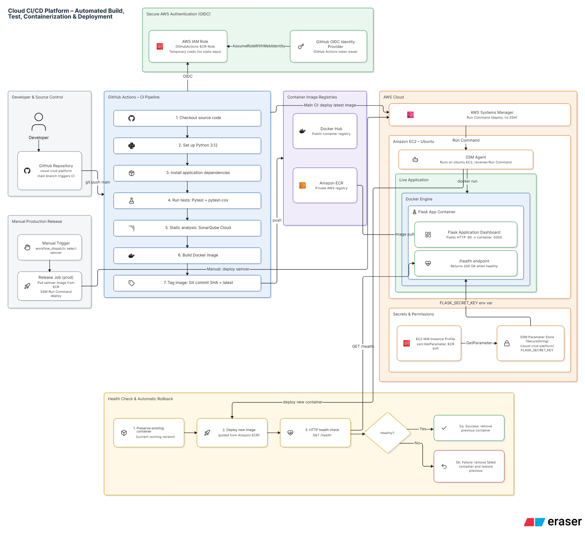
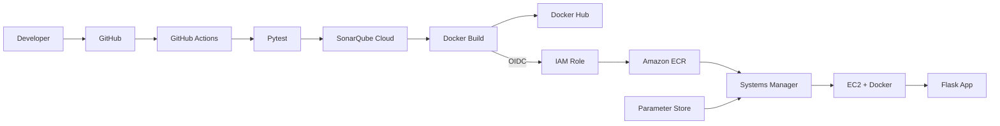

<div align="center">

# ☁️ Cloud CI/CD Platform

**Push code → test → analyse → containerize → publish → deploy → verify.**

A Flask app delivered from GitHub to **AWS EC2** with **GitHub Actions, Docker, SonarQube Cloud, Amazon ECR, Systems Manager and GitHub OIDC**. No SSH, no long-lived AWS keys.

[](https://github.com/Siddhiayare03/cloud-cicd-platform/actions/workflows/ci.yml)
[](https://sonarcloud.io/summary/new_code?id=Siddhiayare03_cloud-cicd-platform)


</div>

---

## 📌 Overview

On every push to `main`, GitHub Actions:

1. Runs **Pytest** with coverage
2. Analyses code with **SonarQube Cloud**
3. Builds a **Docker** image tagged with the Git SHA and `latest`
4. Publishes to **Docker Hub** and **Amazon ECR**
5. Authenticates to AWS with **GitHub OIDC**
6. Deploys to **EC2** through **Systems Manager**, pulling the secret from **Parameter Store**
7. Verifies the app via its `/health` endpoint

Tagged releases (`vX.Y.Z`) build versioned images and a GitHub Release. A separate manual workflow deploys a chosen version with automatic rollback.

---

## 🏗️ Architecture





---

## 🧰 Tech Stack

| Area | Tools |
|---|---|
| App | Python 3.12, Flask |
| CI/CD | GitHub Actions |
| Quality | Pytest, pytest-cov, SonarQube Cloud |
| Containers | Docker, Docker Hub, Amazon ECR |
| AWS | EC2, Systems Manager, Parameter Store, IAM, OIDC |

---

## 📁 Structure

```text
.github/workflows/
├── ci.yml                  # Test, analyse, build, publish, deploy
├── release.yml             # Tag-triggered versioned release
└── production-deploy.yml   # Manual versioned deploy with rollback
app/                        # Flask app (app.py, requirements.txt)
tests/                      # Pytest suite
Dockerfile
sonar-project.properties
```

---

## ⚡ Quick Start

```bash
git clone https://github.com/Siddhiayare03/cloud-cicd-platform.git
cd cloud-cicd-platform
python -m venv venv && source venv/bin/activate    # Windows: .\venv\Scripts\Activate.ps1
pip install -r app/requirements.txt
export FLASK_SECRET_KEY=$(python -c "import secrets; print(secrets.token_urlsafe(32))")
python app/app.py                                  # http://localhost:5000  (health: /health)
```

<details>
<summary><b>Run tests / run with Docker</b></summary>

```bash
# tests
FLASK_SECRET_KEY=local-test-secret python -m pytest tests -v --cov=app --cov-report=term-missing

# docker
docker build -t cloud-cicd-platform .
docker run -d --name cicd-app -p 5000:5000 -e FLASK_SECRET_KEY="$FLASK_SECRET_KEY" cloud-cicd-platform
```

PowerShell users: set the variable with `$env:FLASK_SECRET_KEY = ...` and use `` ` `` for line breaks.

</details>

---

## 🔄 CI/CD Pipeline

| Stage | What happens |
|---|---|
| Test | Pytest + coverage |
| Analyse | SonarQube Cloud scan |
| Build and tag | Docker image: `<git-sha>`, `latest`, or `vX.Y.Z` on releases |
| Publish | Docker Hub and Amazon ECR |
| Deploy | SSM Run Command on EC2, secret read from Parameter Store |
| Verify | `/health` check |


<details>
<summary><b>Earlier runs: Docker Hub, ECR, SSM deploy and v1.0.0 to v1.0.2 releases</b></summary>


</details>

**Releases:** `git tag v1.0.3 && git push origin v1.0.3` builds the versioned image, publishes it and creates a GitHub Release.

---

## 🔍 Code Quality

SonarQube Cloud analyses every push (config in `sonar-project.properties`, token in the `SONAR_TOKEN` secret).


---

## ☁️ AWS Integration

- **Keyless auth:** GitHub OIDC assumes an IAM role (temporary credentials). The trust policy is scoped to this repo.
- **Registry:** private ECR repo `cloud-cicd-platform` in `ap-south-1`.
- **Deploy:** SSM Run Command on EC2 (no SSH). The container is exposed on port 80 and forwards to 5000.
- **Secrets:** `FLASK_SECRET_KEY` is a `SecureString` at `/cloud-cicd-platform/FLASK_SECRET_KEY`, read via the instance profile and injected as an env var, never baked into the image.

| EC2 instance | SSM managed node |
|:---:|:---:|
|  |  |

| ECR: latest builds | ECR: release tag |
|:---:|:---:|
|  |  |

| Docker-hub | Images |
|:---:|:---:|
|  |  |

---

## 🔁 Production Deploy and Rollback

A manually triggered workflow takes a version (e.g. `v1.0.2`), pulls it from ECR, keeps the current container as a backup, starts the new one and checks `/health`. On success the backup is removed. On failure the new container is removed and the previous one restored.

---

## 🔐 Secrets

Add under **Settings → Secrets and variables → Actions**: `DOCKERHUB_USERNAME`, `DOCKERHUB_TOKEN`, `SONAR_TOKEN`, `AWS_ROLE_ARN`, `EC2_INSTANCE_ID`.

Never commit tokens, keys or credentials.

---

## 📊 Status

| Capability | Status |
|---|---|
| CI: tests, SonarQube, Docker build | ✅ Verified |
| Docker Hub and ECR publishing | ✅ Verified |
| OIDC auth, SSM deploy to EC2, health check | ✅ Verified |
| Parameter Store secret retrieval | ✅ Implemented |
| Tag-based release workflow (v1.0.0 to v1.0.2) | ✅ Verified |
| Manual production deploy workflow | ✅ Verified |


---

## 👩‍💻 Author

**Siddhi Ayare** · B.Tech, Electronics and Computer Science, Vidyalankar Institute of Technology

[](https://github.com/Siddhiayare03)
[](https://www.linkedin.com/in/siddhi-ayare/)

<div align="center">

⭐ If you find this project useful, consider giving it a star!

</div>
