<div align="center">

# ☁️ Cloud CI/CD Platform

**Push code → test → analyse → containerize → publish → deploy → verify → roll back if needed.**

An end-to-end DevOps project that ships a Flask app from GitHub to a running container on **AWS EC2** using **GitHub Actions, Docker, SonarQube Cloud, Amazon ECR, AWS Systems Manager and GitHub OIDC**. No SSH and no long-lived AWS keys.

[](https://github.com/Siddhiayare03/cloud-cicd-platform/actions/workflows/ci.yml)
[](https://sonarcloud.io/summary/new_code?id=Siddhiayare03_cloud-cicd-platform)


[Overview](#-overview) · [Architecture](#-architecture) · [Quick Start](#-quick-start) · [Pipeline](#-cicd-pipeline) · [AWS](#-aws-integration) · [Rollback](#-production-deployment-and-rollback) · [Status](#-project-status) · [Screenshots](#-screenshots) · [Roadmap](#-roadmap)

</div>

---

## 📌 Overview

Instead of manually testing, building, publishing and deploying every change, **GitHub Actions orchestrates the whole delivery process**: from a `git push` to a verified, running container on EC2.

### What happens when code is pushed to `main`?

1. 📥 Checks out the latest source code
2. 🐍 Sets up Python 3.12 and installs dependencies
3. 🧪 Runs automated tests with **Pytest**
4. 🔍 Runs static analysis with **SonarQube Cloud**
5. 🐳 Builds a **Docker** image
6. 🏷️ Tags it with the **Git commit SHA** and `latest`
7. 📦 Publishes to **Docker Hub** and **Amazon ECR**
8. 🔐 Authenticates with AWS via **GitHub OIDC**
9. 🛰️ Runs deployment commands on EC2 through **AWS Systems Manager**
10. 🗝️ Fetches the app secret from **Parameter Store**
11. 🚀 Starts the updated container and verifies its **health**

---

## ✨ Key Features

| | Feature | Implementation |
|---|---|---|
| ⚙️ | Automated CI/CD | GitHub Actions |
| 🧪 | Automated testing | Pytest + pytest-cov |
| 🔍 | Code quality | SonarQube Cloud |
| 🐳 | Containerization | Docker |
| 🏷️ | Image tagging | Git SHA and `latest` |
| 📦 | Registries | Docker Hub and Amazon ECR |
| 🔐 | AWS authentication | GitHub OIDC + IAM |
| ☁️ | Cloud deployment | Amazon EC2 |
| 🛰️ | Remote execution | AWS Systems Manager (SSM) |
| 🗝️ | Secret management | SSM Parameter Store (SecureString) |
| 🏷️ | Release automation | Git tag-triggered workflow |
| 🚀 | Production deployment | Manual, version-based |
| ♻️ | Recovery | Container backup and health-check-based rollback |

---

## 🏗️ Architecture

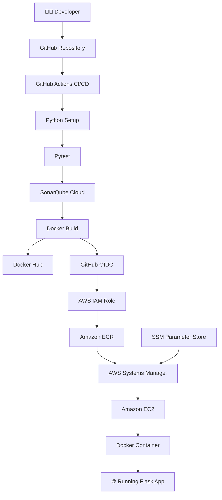

<details>
<summary><b>📖 Component responsibilities</b></summary>

| Component | Responsibility |
|---|---|
| GitHub | Source control and version history |
| GitHub Actions | CI/CD workflow orchestration |
| Pytest | Automated application testing |
| SonarQube Cloud | Static code analysis |
| Docker | Application containerization |
| Docker Hub | Container image publishing |
| GitHub OIDC | Keyless authentication with AWS |
| AWS IAM | Identity and permission management |
| Amazon ECR | Private Docker image registry |
| AWS Systems Manager | Remote EC2 command execution |
| Parameter Store | Secure application secret storage |
| Amazon EC2 | Compute for the deployed application |

</details>

---

## 🧰 Tech Stack

| Layer | Technologies |
|---|---|
| Language | Python 3.12 |
| Framework | Flask |
| Source control | Git, GitHub |
| CI/CD | GitHub Actions |
| Testing | Pytest, pytest-cov |
| Code quality | SonarQube Cloud |
| Containers | Docker |
| Registries | Docker Hub, Amazon ECR |
| Cloud | AWS (EC2, ECR, SSM, IAM) |
| Identity | IAM, GitHub OIDC |
| Secrets | SSM Parameter Store, GitHub Secrets |

---

## 📁 Project Structure

```text
cloud-cicd-platform/
├── .github/
│   └── workflows/
│       ├── ci.yml                  # Test, analyse, build, publish, deploy
│       ├── release.yml             # Tag-triggered release workflow
│       └── production-deploy.yml   # Manual versioned deploy with rollback
├── app/
│   ├── __init__.py
│   ├── app.py                      # Flask application
│   └── requirements.txt
├── tests/
│   └── test_app.py
├── Dockerfile
├── sonar-project.properties
├── README.md
└── .gitignore
```

| Workflow | Responsibility |
|---|---|
| `ci.yml` | Testing, SonarQube analysis, image publishing and EC2 deployment |
| `release.yml` | Release workflow triggered by semantic version tags |
| `production-deploy.yml` | Manual deployment of a chosen version, with health checks and rollback |

---

## ⚡ Quick Start

### Prerequisites

Git · Python 3.12 · Docker Desktop · GitHub account · Docker Hub account

### 1. Clone

```powershell
git clone https://github.com/Siddhiayare03/cloud-cicd-platform.git
cd cloud-cicd-platform
```

### 2. Set up Python

<details open>
<summary><b>🪟 Windows PowerShell</b></summary>

```powershell
python -m venv venv
.\venv\Scripts\Activate.ps1
pip install -r app/requirements.txt
```

</details>

<details>
<summary><b>🐧 macOS / Linux</b></summary>

```bash
python3 -m venv venv
source venv/bin/activate
pip install -r app/requirements.txt
```

</details>

### 3. Configure the Flask secret

The app requires `FLASK_SECRET_KEY`.

```powershell
# PowerShell
$env:FLASK_SECRET_KEY = python -c "import secrets; print(secrets.token_urlsafe(32))"
```

```bash
# macOS / Linux
export FLASK_SECRET_KEY=$(python -c "import secrets; print(secrets.token_urlsafe(32))")
```

> [!WARNING]
> Never commit production secrets to the repository.

### 4. Run locally

```powershell
python app/app.py
```

| URL | Purpose |
|---|---|
| `http://localhost:5000` | Application |
| `http://localhost:5000/health` | Health endpoint |

### 5. Run tests

```powershell
$env:FLASK_SECRET_KEY = "local-test-secret"
python -m pytest tests -v --cov=app --cov-report=term-missing
```

### 6. Run with Docker

```powershell
docker build -t cloud-cicd-platform .

$env:FLASK_SECRET_KEY = python -c "import secrets; print(secrets.token_urlsafe(32))"

docker run -d `
  --name cicd-app `
  -p 5000:5000 `
  -e "FLASK_SECRET_KEY=$env:FLASK_SECRET_KEY" `
  cloud-cicd-platform
```

<details>
<summary><b>🔧 Useful Docker commands</b></summary>

```powershell
docker ps
docker images
docker logs cicd-app
docker stop cicd-app
docker rm cicd-app
```

</details>

---

## 🔄 CI/CD Pipeline

The main workflow triggers on pushes to `main`.

| # | Stage | Operation | Purpose |
|---|---|---|---|
| 1 | Checkout | GitHub checkout | Fetch repository code |
| 2 | Setup | Python 3.12 | Prepare the environment |
| 3 | Dependencies | `pip install` | Install app dependencies |
| 4 | Testing | Pytest | Validate behaviour |
| 5 | Code analysis | SonarQube Cloud | Analyse code quality |
| 6 | Build | Docker | Build the app image |
| 7 | Tag | Git SHA + `latest` | Identify the image |
| 8 | Publish | Docker Hub + ECR | Store container images |
| 9 | Authenticate | GitHub OIDC | Get temporary AWS credentials |
| 10 | Deploy | AWS SSM + EC2 | Run the container |
| 11 | Verify | `/health` endpoint | Confirm availability |

### 🏷️ Image tagging

```text
cloud-cicd-platform:latest        # most recent main build
cloud-cicd-platform:<git-sha>     # exact source commit
cloud-cicd-platform:v1.0.2        # semantic-version release
```

---

## 🏷️ Release Management

The release workflow runs when a semantic version tag is pushed:

```powershell
git tag v1.0.3
git push origin v1.0.3
```

It is designed to:

1. Build the Docker image
2. Tag it with the release version and Git SHA
3. Publish to Docker Hub and Amazon ECR
4. Create a GitHub Release with generated notes

> [!NOTE]
> Release workflow execution should be verified separately before treating the full release process as production-tested.

---

## ☁️ AWS Integration

### 1. Keyless auth with GitHub OIDC

No long-lived AWS access keys are stored in GitHub.

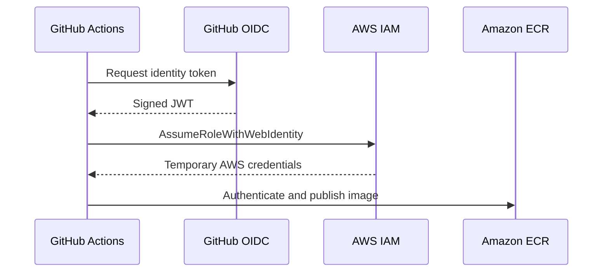

The IAM trust policy should restrict access to the intended repository and workflow context.

### 2. Amazon ECR

| Setting | Value |
|---|---|
| Repository | `cloud-cicd-platform` |
| Region | `ap-south-1` |

### 3. EC2 deployment

1. GitHub Actions assumes the IAM role
2. Sends a deployment command through AWS Systems Manager
3. EC2 authenticates with ECR
4. EC2 pulls the requested image
5. EC2 retrieves the secret from Parameter Store
6. Docker starts the updated container
7. The health endpoint is checked

The app is exposed on **port 80** of the EC2 instance, forwarded by Docker to **port 5000** in the container.

### 4. AWS Systems Manager

**Run Command** executes deployment steps remotely, so GitHub Actions doesn't need SSH access to the instance.

### 5. Secret management

The production Flask secret is a `SecureString` in Parameter Store:

```text
/cloud-cicd-platform/FLASK_SECRET_KEY
```

The EC2 instance reads it at deploy time through its **IAM instance profile** and injects it into the container as an environment variable. It is never baked into the Docker image.

---

## 🔁 Production Deployment and Rollback

A separate, **manually triggered** workflow deploys a chosen release (for example `v1.0.2`).

### Deployment steps

1. Validate the semantic version
2. Authenticate with AWS via OIDC
3. Pull the requested version from ECR
4. Retrieve the production secret from Parameter Store
5. Preserve the existing container
6. Start the requested release
7. Check `/health`
8. Remove the previous container after successful verification

### Automatic rollback

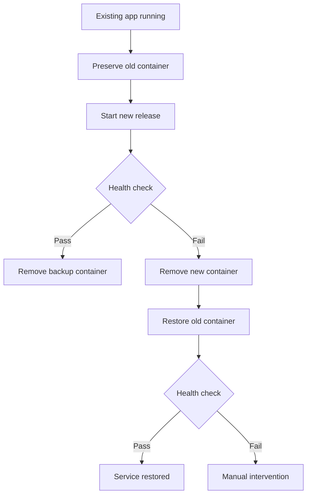

Rollback uses Docker container stop, rename, remove and start operations.

> [!IMPORTANT]
> The rollback logic is implemented, but **deliberate failure-based rollback testing is not complete yet**. Replacing the container can also cause **brief downtime**.

---

## 🔐 Configuration and Secrets

### GitHub Actions secrets

Add them under **Repository → Settings → Secrets and variables → Actions**:

| Secret | Purpose |
|---|---|
| `DOCKERHUB_USERNAME` | Docker Hub username |
| `DOCKERHUB_TOKEN` | Docker Hub access token |
| `SONAR_TOKEN` | SonarQube Cloud authentication |
| `AWS_ROLE_ARN` | IAM role assumed through OIDC |
| `EC2_INSTANCE_ID` | Target EC2 instance ID |

The production app secret lives separately in AWS Parameter Store.

### Security practices

- ✅ GitHub OIDC instead of long-lived AWS keys
- ✅ IAM roles with scoped permission policies
- ✅ `SecureString` for the production app secret
- ✅ No production secrets in source control
- ✅ Static analysis on every push
- ✅ Traceable, SHA-tagged images
- ✅ No SSH-based deployment

---

## 🔍 SonarQube Cloud

Analysis runs in CI and is configured in `sonar-project.properties`. It reports:

- 🐞 Bugs
- 👃 Code smells
- 🔒 Security-related findings
- 🧹 Maintainability issues
- 🛡️ Reliability issues

Authentication uses the `SONAR_TOKEN` GitHub Actions secret.

---

## 📊 Project Status

| Capability | Status |
|---|---|
| GitHub Actions CI/CD | ✅ Implemented |
| Pytest automated testing | ✅ Implemented |
| Docker image build | ✅ Verified |
| Docker Hub publishing | ✅ Verified |
| SonarQube Cloud analysis | ✅ Verified |
| AWS OIDC authentication | ✅ Implemented |
| Amazon ECR publishing | ✅ Verified |
| EC2 container deployment | ✅ Verified |
| AWS SSM remote deployment | ✅ Verified |
| Parameter Store secret retrieval | ✅ Implemented |
| Production health checks | ✅ Verified |
| Version-based deployment workflow | ⚙️ Configured |
| Automatic rollback | ⚙️ Implemented, failure testing pending |
| Release automation | ⚙️ Configured, execution verification pending |

---

## 📸 Screenshots

Real output from the running pipeline and AWS environment.

### 🌐 Live application on EC2

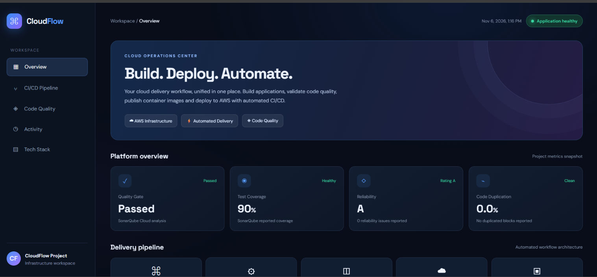

### ☁️ AWS infrastructure

| EC2 instance | Systems Manager managed node |
|:---:|:---:|
| 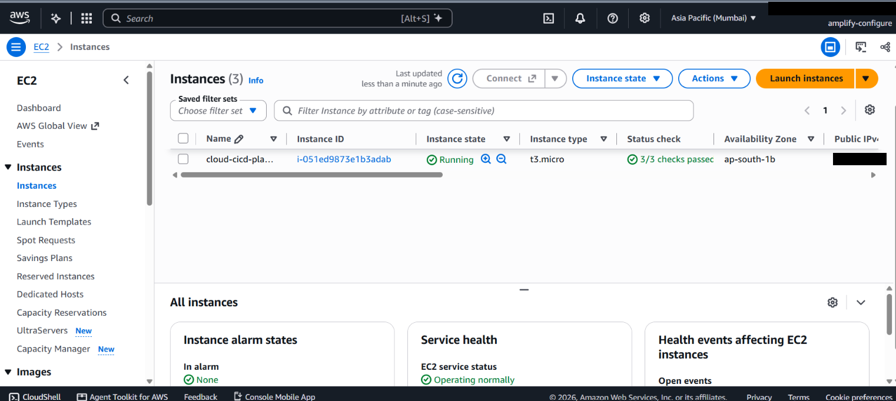 | 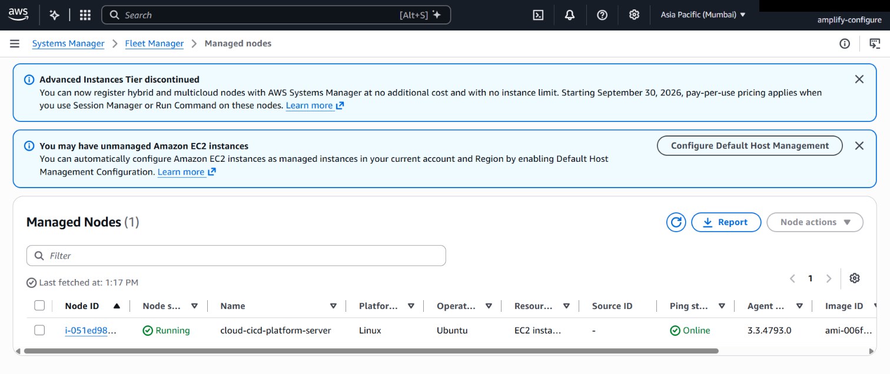 |
| Instance running with all status checks passed | Instance registered and **Online** in Fleet Manager, used for SSM deployments |

### 📦 Container registries

| Amazon ECR: latest builds | Amazon ECR: release tag |
|:---:|:---:|
| 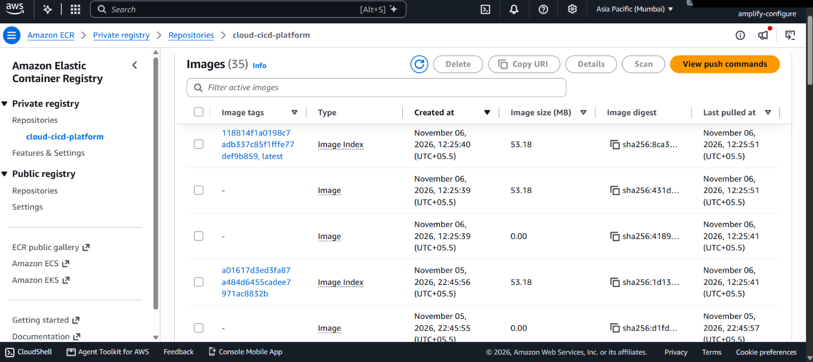 | 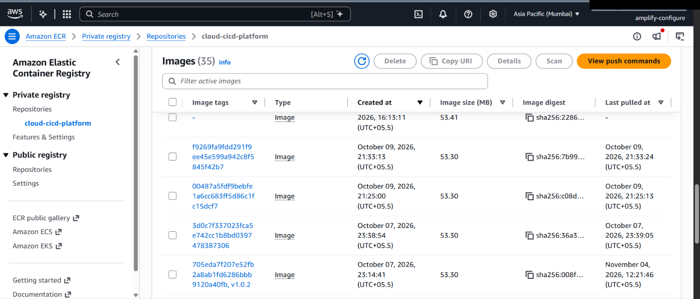 |
| Images tagged with the Git SHA and `latest` | Earlier images, including the `v1.0.2` release tag |

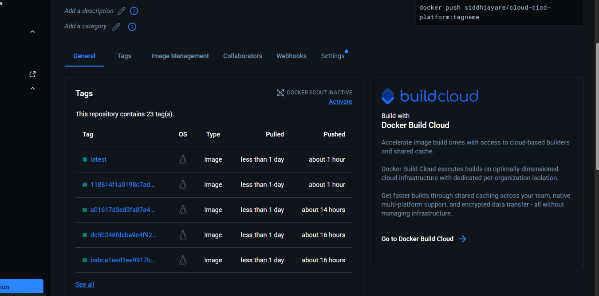

**Docker Hub:** `latest` and SHA-tagged images published by the pipeline.

### 🔍 Code quality

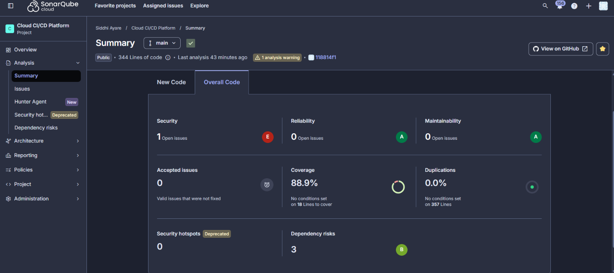

**SonarQube Cloud:** analysis of `main` with Reliability A, Maintainability A, 88.9% coverage and 0.0% duplication.

### ⚙️ GitHub Actions history

<details open>
<summary><b>Recent runs: CI, production deployment and rollback work</b></summary>

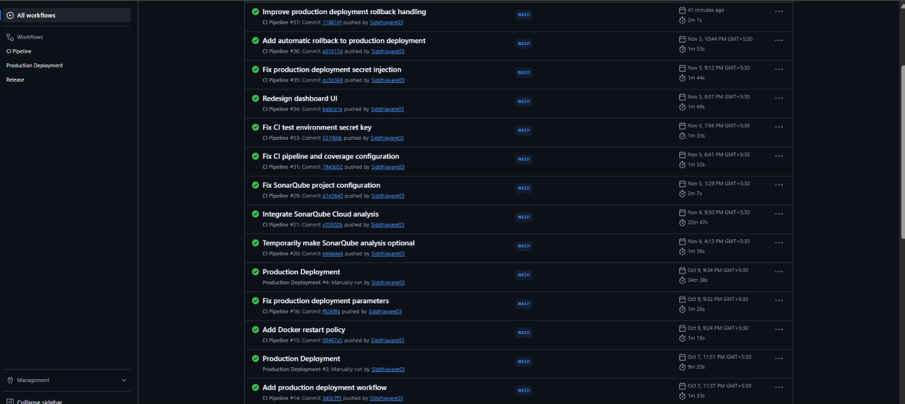

</details>

<details>
<summary><b>Earlier runs: Docker Hub, ECR, SSM deployment and versioned releases</b></summary>

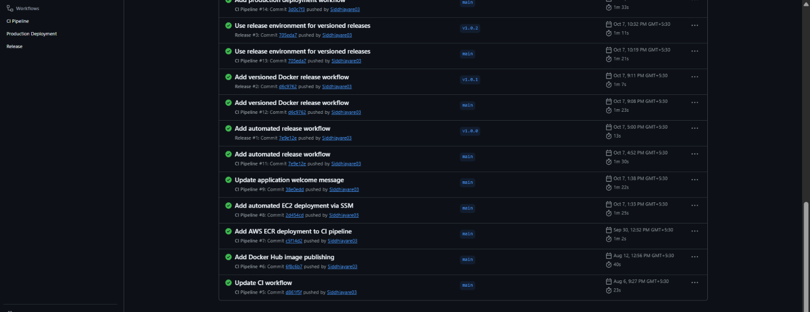

</details>

---

## 🧠 Challenges and Learnings

| Challenge | What I learned / implemented |
|---|---|
| CI pipeline failures | Debugged dependency, Python version and test configuration issues |
| Docker image management | Tagged images with Git SHA and semantic versions |
| SonarQube integration | Configured static analysis and worked towards passing the quality gate |
| AWS authentication | Implemented GitHub OIDC federation to avoid long-lived credentials |
| EC2 deployment | Used SSM Run Command to deploy containers remotely |
| Secret management | Retrieved production secrets securely from Parameter Store |
| Deployment reliability | Added health checks and rollback logic |
| Troubleshooting | Debugged GitHub Actions, IAM permissions, ECR auth and deploy failures |

### Key takeaways

- CI/CD is more than automating builds: it covers testing, security, deployment and recovery.
- Image tagging makes deployments traceable and reproducible.
- OIDC is a safer way for CI/CD systems to access cloud resources.
- Health checks and rollback improve deployment reliability.
- Troubleshooting failures is an essential part of building production-oriented infrastructure.

---

## 🗺️ Roadmap

- [ ] Infrastructure as Code with **Terraform**
- [ ] Kubernetes orchestration with **Amazon EKS**
- [ ] Monitoring and alerting with **Prometheus and Grafana**
- [ ] Distributed tracing with **OpenTelemetry**
- [ ] Container vulnerability scanning with **Trivy**
- [ ] Multi-environment deployments (dev, staging, production)
- [ ] Zero-downtime deployment strategy
- [ ] Failure-injection testing for automated rollback
- [ ] Deployment notifications and improved observability

---

## 🤝 Contributing

Contributions, issues and suggestions are welcome.

1. Fork the repository
2. Create a feature branch
3. Commit your changes
4. Push the branch
5. Open a Pull Request

---

## 👩‍💻 Author

**Siddhi Ayare**
B.Tech, Electronics and Computer Science · Vidyalankar Institute of Technology
Cloud Computing · DevOps · Infrastructure Automation · AWS · CI/CD

[](https://github.com/Siddhiayare03)
[](https://www.linkedin.com/in/siddhi-ayare/)

---

<div align="center">

**Build → Test → Containerize → Deploy → Automate**

⭐ If you find this project useful, consider giving the repository a star!

</div>
